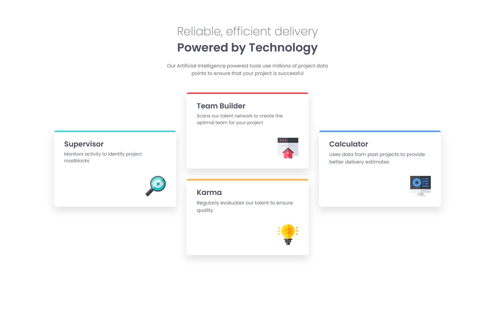

- [Overview](#overview)
  - [Screenshot](#screenshot)
  - [Links](#links)
  - [Built with](#built-with)
- [Author](#author)

## Overview

A four card feature section built with HTML & CSS

### Screenshot

### Links

- Solution URL: [Solution](https://github.com/nakirabloody37/four-card-feature-section)
- Live Site URL: [Live site](https://nakirabloody37.github.io/four-card-feature-section/)

### Built with

- Semantic HTML5 markup
- CSS custom properties
- Flexbox
- CSS Grid
- Mobile-first workflow

## Author

- Frontend Mentor - [@nakirabloody37](https://www.frontendmentor.io/profile/nakirabloody37)
